<div align="center">



<br/>

[](https://github.com/SLASH-X-exe)


<br/>

**I don't just write code. I build, explore, and understand how systems work.**

`SECURITY` &nbsp; / &nbsp; `DEVELOPMENT` &nbsp; / &nbsp; `AUTOMATION`

</div>



<table>
<tr>
<td width="58%" valign="top">



```text
IDENTITY   : SLASH/X
DOMAIN     : CYBERSECURITY
DISCIPLINE : SOFTWARE DEVELOPMENT
INTERESTS  : WEB / SYSTEMS / SECURITY
MINDSET    : LOGIC OVER NOISE
```

I’m interested in cybersecurity, software engineering, web technologies, and building practical tools.

- Exploring security concepts and defensive techniques.
- Developing websites, scripts, and software projects.
- Learning how applications and systems work.
- Improving through experimentation and hands-on practice.

</td>
<td width="42%" valign="top">



```python
class SLASH_X:
    focus = "Security"
    build = "Software"
    explore = "Systems"

    def mission(self):
        return [
            "Learn",
            "Build",
            "Improve"
        ]
```

**OBJECTIVE**

Understand the system.  
Build the solution.  
Make it better.

</td>
</tr>
</table>









<div align="center">

<a href="https://github.com/SLASH-X-exe">

</a>
<a href="https://github.com/SLASH-X-exe">

</a>

<br/>


</div>




<div align="center">


[](https://github.com/SLASH-X-exe?tab=overview)

</div>




<div align="center">

<a href="https://github.com/SLASH-X-exe?tab=repositories">

</a>
<a href="https://github.com/SLASH-X-exe?tab=stars">

</a>
<a href="https://github.com/SLASH-X-exe?tab=followers">

</a>

<br/><br/>

[**OPEN GITHUB PROFILE →**](https://github.com/SLASH-X-exe)

</div>



